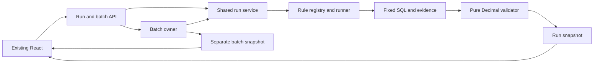

# Sprint 2 requirements and acceptance mapping

Snapshot: 2026-11-17, `main@45216b1`. These IDs index this delivery without
renaming Sprint 1 stories. Results refer to the [integrated evidence](../testing/sprint2-integrated-acceptance.md).

## User stories

| ID | User story | Acceptance | Code / verification |
|---|---|---|---|
| S2-US-01 / F2 | As an analyst, I want claims compared with actual query evidence so I can distinguish correct and unsupported values. | Growth 10 and 10.01 pass, 10.02 fails; total 11000 cents passes, 11001 fails, fractional cents are unverifiable; Decimal decides acceptance. | `harness/rules.py`, `validation.py`; verification tests, `harness.spec.ts` |
| S2-US-02 / F2 | As an evaluator, I want evidence defects distinguished from execution errors so neither creates a false pass. | Match run, reference, dataset, scope and unit; invalid/foreign/ambiguous evidence is unverifiable; model/query/validator exceptions are tool errors with safe codes. Unsupported requests fail before execution. | `contracts.py`, `runner.py`, `validation.py`; contract/verification/trace tests |
| S2-US-03 / F3 | As a reviewer, I want a result linked to observable steps, SQL and evidence so I can inspect its basis. | Claim → same-run evidence → completed query references agree; display status/time/duration and known usage without inventing missing metrics or hidden reasoning. | `trace.py`, `runner.py`, React trace components; trace unit/browser tests |
| S2-US-04 / F4 | As an evaluator, I want versioned case selection and interpretable summaries. | Growth set: 10 cases, 2/4/4; mixed set: 8 cases, 3/2/3 (passed/failed/unverifiable). Tool errors stay separate; expected labels never enter execution/model input; source overrides remain isolated. | `cases.py`, `batch.py`, batch API/panel; batch/mixed-case/source tests |
| S2-US-05 / F4 | As an evaluator, I want a failed or expired case to preserve unrelated confirmed work. | Later cases continue within the batch budget; batch expiry stops dispatch and marks the tail skipped. Actual close finishes before terminal persistence, even under repeated cancellation. | `batch.py`, `batch_store.py`; real SQLite lifecycle and fault regressions |
| S2-US-06 / F3+F4 | As a user, I want reports to reopen unchanged after reload/restart. | Saved runs survive reload/restart; expired unowned running batches get a read-only interrupted projection, without invented finish time or successful save; legacy snapshots remain readable. | `store.py`, `batch_store.py`; contract/lifecycle/browser tests and 18-report restart check |

All stories passed within fixed-data automated acceptance. Model doubles verify
`agent_generated` orchestration, not live-provider acceptance. Fault injection is
identified separately from successful ordinary execution and hard process crashes.

## Non-functional requirements and tradeoffs

| Requirement | Contract and rationale | Evidence / limitation |
|---|---|---|
| NFR-01 Reliability | Dedicated case and metadata sessions; owned task/thread/close cleanup; synchronous sequential 1–20-case batches; default budgets 60/300 s, maxima 120/600 s; confirmed reports preserved. | [Budget design](sprint2-batch-budgets.md), #27 and lifecycle/mixed tests. One worker/replica; cleanup can outlast the budget, no hard-kill SLA. |
| NFR-02 Modifiability | `RULES` selects pure rule-specific query/claim/validation; batch calls the shared service, with common evidence and storage. F2 extended request types and UI selection without duplicating batch formulas or redesigning storage. | [F2 design](sprint2-verification-f2.md), #23 and mixed tests. One second fixed rule is demonstrated, not arbitrary-rule zero-change extensibility. |
| Trace measurement | Unknown measurements remain nullable; paired offline version comparison and claim-helper measurement. | [#28 record](../testing/sprint2-trace-performance.md). Historical Linux samples exclude provider/HTTP/report-DB costs; no general latency threshold. |
| Reproducibility / compatibility | Lockfiles, explicit bootstrap, schema-1 reads/schema-2 writes, real-SQL tests and cross-platform CI. | Integrated evidence; full Windows UI and persisted real-provider replay remain Sprint 3 tasks. |

NFR-01/02 continue the existing requirements. The final two rows are quality
evidence, not new school-mandated NFR numbers.

## Design boundary

A completed execution is distinct from a passing claim. The service owns initial
and final run snapshots; the batch owns sessions, budgets and aggregation without
copying formulas. Traces capture observable events, not hidden model reasoning.

---

# 中文：Sprint 2 需求与验收对照

基线为 2026-11-17 的 `main@45216b1`。S2-US 编号仅索引本轮交付，不改写 Sprint 1 原编号。

- **S2-US-01**：分析者依据真实 SQL 证据验证数值；增长率 10/10.01 通过、10.02 失败；总额 11000 分通过、11001 分失败、小数分无法验证，用 Decimal 判定。
- **S2-US-02**：评测者区分证据缺陷与执行故障；核对运行、引用、数据、范围和单位，无效关联无法验证，执行异常为工具错误，非法请求提前拒绝。
- **S2-US-03**：评审者从结果追溯到声明、同运行证据和已完成查询；只展示实际步骤和已知指标，不补造隐藏推理或缺失数据。
- **S2-US-04**：选择版本化案例集，得到原 10 例 2/4/4、混合 8 例 3/2/3 汇总；工具错误另计，预期标签不进入执行，来源覆盖保持隔离。
- **S2-US-05**：单例失败/到期保留已确认结果，在整批预算内继续；整批到期不启动尾部；重复取消也等实际关闭结束后才保存终态。
- **S2-US-06**：刷新/重启后报告内容不变；过期无归属运行只读投影为中断，不虚构完成/保存，兼容旧快照。

以上在固定数据自动验收范围内通过，文件与测试映射见英文表格。模型替身不冒充真实模型验收；故障注入、正常运行和进程崩溃分开说明。

**NFR-01 可靠性**：独立 session、任务/线程/连接清理、同步 1–20 例；默认 60/300 秒、上限 120/600 秒。
单 worker/单副本，清理可超预算，无硬终止承诺。
**NFR-02 可修改性**：规则注册、纯验证与共同服务使总额复用批次、证据和存储；扩展了请求类型与 UI 选择，
没有复制批次公式或重建存储，但不泛化为任意规则零改动。
性能证据沿用 #28 的限定离线范围；复现证据包括锁文件、迁移、旧快照及跨平台 CI。
后两项不虚构新的学校 NFR 编号，完整 Windows UI 和真实模型持久化验收留到 Sprint 3。

上图明确 UI/API、批次、共同服务、规则、SQL/证据、纯数值验证和报告存储边界。
执行结束不等于声明通过，批次不复制公式，轨迹不记录隐藏推理。
